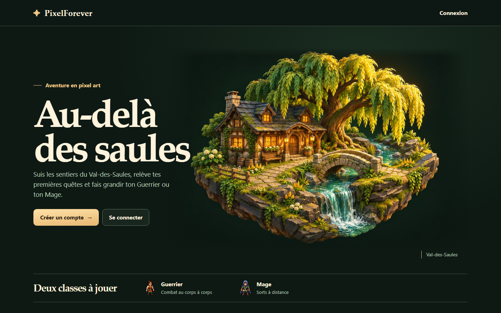
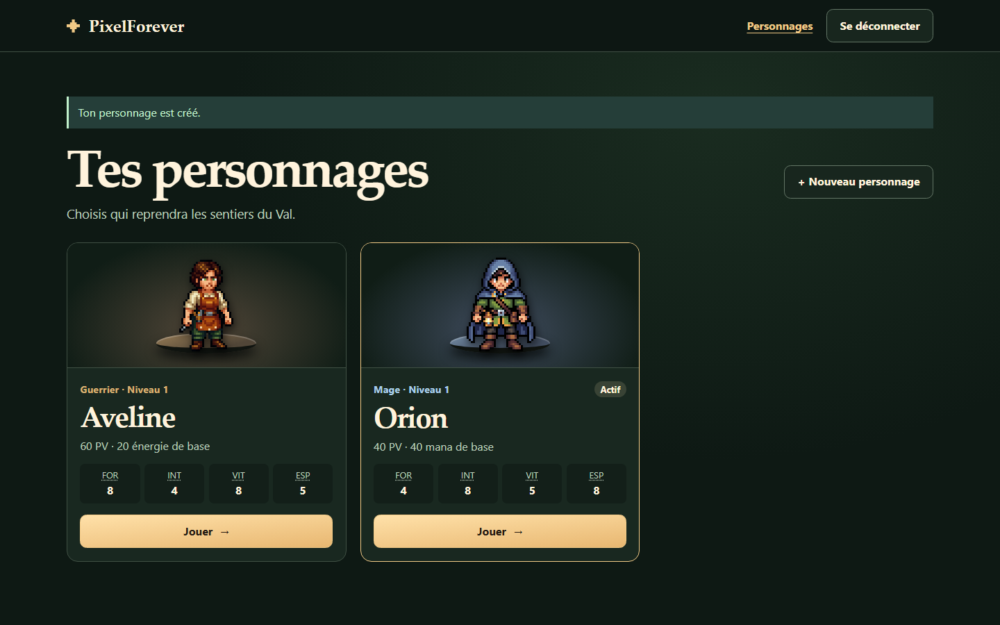

# PixelForever

PixelForever est un projet de **MMORPG en pixel art** conçu pour être joué dans un navigateur. Inspiré par l’exploration et les quêtes de *World of Warcraft*, il vise à créer un monde partagé où les joueurs peuvent se croiser, explorer et combattre ensemble en temps réel. Symfony et Doctrine gèrent déjà les comptes, les personnages et la sauvegarde du niveau/XP. La présence des autres joueurs est intégrée ; les combats contre des monstres partagés restent à développer.

Le prototype jouable utilise Phaser 3.90.0, Twig et JavaScript. Les règles PHP historiques de `src/Game/` ne remplacent pas le moteur de combat actuel du navigateur.

Le Chasseur porte son arc verticalement au repos et le tend à deux mains pour tirer. Le Voleur tient des dagues courtes, abaissées au repos. Le Démoniste lance sa magie directement, entouré de volutes d’ombre violettes pendant ses sorts, sans livre visible. Les personnages d’origine sont conservés. [Animations et génération des planches](docs/FRONTEND.md)

Le Chasseur équipé de son arc utilise désormais huit orientations dessinées séparément, avec huit poses de marche et huit poses de tir par orientation. Poussière, décoche, flèche et impact accompagnent ces animations, visibles également sur les personnages distants. [Ressources du Chasseur](docs/CHASSEUR_ART.md)

Le Voleur utilise également huit orientations de marche et de frappe, avec les dagues tenues dans les mains, un portrait assorti et des VFX animés d'entaille, de Rafale, de venin et de Pas de l'ombre. [Ressources du Voleur](docs/VOLEUR_ART.md)

## Aperçu

### Accueil du Val-des-Saules



### Choix du personnage



## Lancer PixelForever avec PostgreSQL

```sh
docker compose -p pixelforever-postgres up -d --build
```

Ouvre [PixelForever](http://127.0.0.1:8080). PostgreSQL conserve les comptes et les personnages dans le volume Docker `pixelforever-postgres_accounts`, y compris quand les conteneurs sont recréés. Les identifiants de Compose sont réservés à cette installation locale.

Le [guide de déploiement](docs/DEPLOIEMENT.md) décrit la configuration de Render et les vérifications après mise en ligne.

## Lancer le parcours de compte en local avec SQLite

Le parcours local requiert PHP 8.2 ou ultérieur, Composer et l’extension PHP `pdo_sqlite`. Sous Windows, active `extension=pdo_sqlite` dans le fichier indiqué par `php --ini`.

```sh
composer install
php bin/console doctrine:migrations:migrate --no-interaction
php -S 127.0.0.1:8000 -t public
```

Crée un compte ou connecte-toi, puis choisis l’une des cinq classes dans **Tes personnages**. Clique sur **Jouer** pour apparaître au **Bastion de Braise**, une ville sûre. Les comptes et les personnages sont sauvegardés dans `var/pixelforever.sqlite`. [PixelForever en local](http://127.0.0.1:8000)

## Vérifications locales

```sh
composer test:accounts
node --test tests/*.test.mjs
php bin/console lint:twig templates
```

Le test des comptes utilise une base SQLite temporaire et requiert `pdo_sqlite` et `dom`. Les tests Node couvrent progression, sauvegarde réseau, quête, exploration, armes et animations de combat.

## Version jouable actuelle

- Cinq classes jouables, avec le Guerrier en armure, le Mage, le Démoniste, le Voleur et le Chasseur.
- Carte plein écran de 256 × 252 tuiles de 16 px, caméra suiveuse et zoom ×2 sur les écrans usuels (réglable dans la fonction cameraZoom de public/game/exploration.js). Les falaises délimitent le littoral.
- Sangliers N.1–5, squelettes N.5–10 et dragons N.10–20. À l’est des montagnes, le chemin traverse les Terres dévastées (N.21–35) et rejoint Malakor (N.40). Au sud du Trône d’Obsidienne, une route côtière relie le Marais des Scories, les Remparts de Basalte et le Cap du Gouffre (N.41–60).
- Le cimetière mêle pavés usés, mausolées sculptés, stèles moussues et saules à lichen. Les Terres dévastées alternent cendre striée, basalte, arbres calcinés et arches incandescentes. Les textures se fondent dans le terrain voisin.
- La lumière change progressivement entre la clairière diurne, le cimetière froid et les côtes volcaniques. Lanternes, fissures, sorts et Rage de Malakor éclairent leur voisinage. Chaque biome a ses propres effets d’ambiance, du pollen doré aux étincelles violettes du Cap du Gouffre.
- Les sorts et les techniques de Malakor jouent des cycles pixel art pour la charge, le projectile ou l’impact. Le Tourbillon se dresse en double hélice et l’Onde sismique soulève un anneau d’obsidienne.
- Les monstres ont huit orientations et des animations propres à leur famille. Le souffle du dragon et les techniques des gardiens côtiers signalent au sol les zones à esquiver.
- Parle à Rakka au Bastion (`E` ou clic) pour accepter sa quête. Suis la route vers la clairière, bats trois sangliers, puis reviens recevoir deux potions de vie. `!` doré indique une quête disponible, `?` gris une quête en cours et `?` doré une quête à rendre.

### Combat et équipement

Malakor a 36 000 PV et trois phases. À 65 %, la Brèche balaie le Trône par vagues. À 25 %, la Rage fait traverser une déferlante visuelle sur la carte. Le premier avertissement au sol apparaît environ quatre secondes après le début de la transformation. En Rage, des rayons continus traversent les bandes annoncées. Ils se désagrègent en fragments incandescents et laissent des braises pendant trois secondes.

| Classe / arme | Attaque de base | Portée de base |
| --- | --- | --- |
| Guerrier · épée, croc ou Hache de fer | Coup en mêlée | 2,5 case |
| Mage · Baguette de braise ou Sceptre de Saphyr | Projectile magique | 5 cases avant bonus |
| Mage · Bâton des saules | Coup de bâton | 2,5 case |
| Démoniste · Focalisation d’ombre | Trait d’ombre | 5 cases |
| Voleur · Dagues | Coup de dague | 2,5 case |
| Chasseur · Arc | Flèche rapide | 7 cases |
| Mains nues | Coup de poing | 2,5 case |

L’attaque de base est gratuite. La baguette et le sceptre tirent en mouvement et infligent les dégâts d’auto-attaque complets avant les talents propres à la baguette. Boule de feu porte à 15 cases avant bonus et demande une seconde d’incantation, quelle que soit l’arme équipée. Maîtrise des baguettes (+6 % par rang, 5 rangs) et Focalisation de la baguette (+2 dégâts par rang, 3 rangs) renforcent les tirs. La seconde exige la maîtrise et cinq points dans Arcanes. [Règles des classes et des talents](docs/GAME_DESIGN.md)

Le Démoniste combine Corruption instantanée, des incantations et Drain de vie sur deux secondes. Le diablotin est disponible dès le niveau 1. Le Voleur et le Chasseur utilisent la Dextérité pour leurs dagues et leur arc. Le Guerrier peut investir en Défense et équiper la Hache de fer depuis le sac. Son arme apparaît en main et la hache joue une frappe avec un croissant incandescent. [Effets visuels](docs/VFX.md)

Les sorts de zone du Mage se lancent également à distance : Tourbillon de feu et Nova de givre sont centrés sur la cible sélectionnée, pas sur le mage. L’arme équipée ne réduit la portée d’aucun sort.

Le Guerrier commence avec 60 PV / 20 énergie, le Mage avec 40 PV / 40 mana. L’arme de départ ajoute 4 dégâts de base ; les armes rares et épiques ajoutent 7 et 11. Le niveau, les caractéristiques, les rangs et les talents modifient ensuite les statistiques.

### Progression et butin

Le niveau 1 ne donne aucun point. Chaque montée suivante donne trois points de caractéristiques et un point de talent/sort. Le seuil est `(50 + 10 × niveau) × 4` avant le N.10, ×5 avant le N.30 puis ×6. Une victoire de niveau égal rapporte `50 + 10 × niveau` XP : 316 victoires de référence mènent au N.60. La simulation sans talents ni équipement rare estime 151–178 minutes selon la classe, déplacements et récupération compris ; cela reste à confirmer en jeu. Les anciennes sauvegardes gardent leur niveau et leur fraction d’XP.

Le Chasseur dispose dès le niveau 1 de **Trappe d’apprivoisement** (touche `3`) : neutralisation de la cible pendant 6 s, sans dégâts, puis `W` pour la capturer en 4 s. La trappe exige les mêmes conditions que la capture et se brise au premier dégât ; recharge 20 s, coût en mana affiché.

Le Chasseur peut apprivoiser les créatures de son niveau ou moins, sauf les squelettes, après les avoir affaiblies à 30 % de PV. Chasseur et Démoniste disposent d’une barre de familier W/X/C sur AZERTY (Z/X/C sur QWERTY) ; la fiche passe sur P. Les familiers héritent d’une partie des statistiques du maître équipé. La créature apprivoisée reste sauvegardée localement dans ce lot. [Règles des familiers](docs/GAME_DESIGN.md)

Chaque victoire donne un objet selon un tirage qui réserve 47 % à la vie, 30 % à la ressource, 15 % à une arme rare, 5 % à une arme épique, 2 % à l’Écaille de Saphyr et 1 % au Cœur de flamme bleue. Le type d’arme dépend de la classe. Écailles et cœurs sont des matériaux. Les potions rendent 30 % du maximum, avec un minimum de 20 PV ou 15 points de ressource et une recharge partagée de 15 s. La Citadelle, Malakor, les Remparts et le Cap donnent aussi des coiffes et des gants adaptés à la classe.

Les comptes, personnages et niveau/XP sont en base. Le sac, les pièces équipées, les allocations et la quête restent enregistrés par personnage dans le navigateur. Effacer ce stockage peut donc effacer ces éléments locaux.

## Commandes

Déplacements : flèches, ZQSD ou WASD. `1` attaque de base, `2` compétence principale, `3`–`9` techniques disponibles selon la classe, `R` potion de vie, `F` potion de ressource, `P` fiche, `T` talents, `I` inventaire, `E` dialogue du PNJ à proximité. Les touches d’action utilisent les positions physiques de la rangée supérieure, sans Maj sur AZERTY. Le clic sélectionne un monstre.

Les joueurs proches et les visuels de leurs combats sont transmis en continu par WebSocket : mouvements interpolés, monstres animés et barres de vie, projectiles, zones et familiers. Symfony/PostgreSQL conserve le bail de présence et le tchat de proximité. Les dégâts, l’XP et le butin suivent les règles actuelles. [Fonctionnement et vérifications](docs/VISIBILITE-COMBATS.md)

## Périmètre restant

Les monstres partagés, le combat validé par serveur, le marchand, la vente, l’équipement secondaire et la sauvegarde serveur du sac/talents/quêtes ne sont pas encore intégrés. Le modèle PHP `Character`/`Blob` conserve des règles de prototype historiques testées séparément.

Documentation du projet · [Game design](docs/GAME_DESIGN.md) · [Front-end](docs/FRONTEND.md) · [Back-end](docs/BACKEND.md) · [VFX](docs/VFX.md) · [Déploiement](docs/DEPLOIEMENT.md)

## Sorts et tchat

Chaque sort possède une illustration dédiée. La barre affiche la recharge restante en secondes, y compris sur les commandes de familier. Les compétences trop coûteuses deviennent grises, indiquent le manque de mana/énergie et restent indisponibles jusqu’à récupération ; les auto-attaques gratuites restent utilisables.

Le tchat intégré propose Global, Groupe, Chuchotement et Proximité (12 cases). Entrée ouvre la saisie, Échap revient au jeu. Choisir un personnage dans les suggestions pour chuchoter ou l’inviter. Le groupe privé compte au maximum cinq personnages ; seul son chef invite et son départ dissout le groupe. Les invitations expirent après deux minutes. Les groupes de discussion ne partagent pas encore les monstres, les récompenses ou l’XP.

## Fluidité des autres joueurs

La synchronisation conserve une cadence cible de 300 ms et le navigateur interpole les positions horodatées. Les animations d’attaque sont rejouées image par image, même si une pose courte tombe entre deux échanges. Un bref défaut réseau ne retire plus immédiatement les personnages. Le lot vise les groupes de 2 à 10 joueurs ; le contrôle local reste immédiat, tandis que les acteurs distants utilisent un tampon d’environ 500–850 ms. La capacité réelle et les FPS sur Render restent à mesurer en conditions jouées.

ATH personnalisable : Échap ouvre le menu 16 bits (Options, Modifier l’ATH, Guides). Taille de 70 à 130 %, opacité, cadres déplaçables et maintien du clic de 350 ms pour échanger deux cases de sorts. Une fenêtre de bienvenue et une initiation en sept étapes accompagnent les nouveaux personnages.

Depuis « Mes personnages », le lien « Supprimer » ouvre une confirmation avant la suppression définitive du personnage et de sa progression.

Un petit nombre en haut de l’écran indique le total des personnages actifs sur le serveur, toi compris, quelle que soit leur distance. Les présences expirent après 12 s sans nouvelles ; « — » indique une connexion indisponible.
## Mage : graphismes

Le Mage dispose de nouvelles animations dans huit directions, à la baguette et au bâton, et de six effets magiques animés. [Ressources et vérifications](docs/MAGE_ART.md).

## Clairière jouable

La clairière utilise un sol pixel, un sentier continu, trois espaces dégagés et des décors ponctuels avec collisions. Des rayons chauds et un pollen discret complètent l'ambiance. Voir les paramètres et vérifications dans [la documentation du moteur graphique](docs/FRONTEND.md#clairière-jouable--décors-et-lumière).
